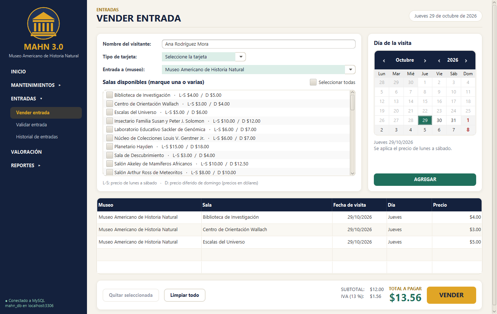
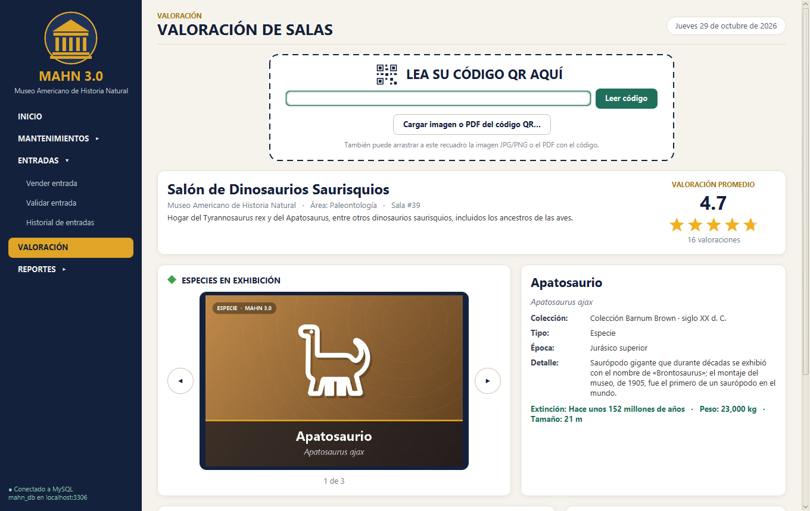

# MAHN 3.0 · Museo Americano de Historia Natural

Proyecto #2 del curso **Programación II** (I Ciclo 2025), Universidad Nacional, Sede Regional Brunca.

Aplicación de escritorio para administrar el museo y vender sus entradas en las cajas. Tiene mantenimientos de la
información del museo, venta de entradas con código QR, validación de entradas, valoración anónima de salas y reportes
en PDF.

## Tecnologías

| Herramienta | Uso |
|---|---|
| Java 17 o superior (probado con JDK 21) | Lenguaje |
| JavaFX 21 + FXML | Interfaz gráfica |
| NetBeans (proyecto Maven) | IDE |
| MySQL 8.0 | Base de datos |
| ZXing 3.5 | Generar y leer códigos QR |
| iText 8 | Comprobantes y reportes en PDF |
| Git | Control de versiones |

## Módulos

- **Mantenimientos** (Interfaz No. 1): museos, salas, colecciones, especies, temáticas, precios y comisiones de tarjetas.
  Cada uno permite insertar, editar, eliminar y filtrar con un `TextField` y un `ComboBox` cargado desde la base de datos.
- **Entradas**
  - *Vender entrada* (Interfaz No. 2): se elige el visitante, la tarjeta, el museo, las salas y los días en un calendario.
    El precio sale de la base de datos (lunes a sábado o domingo) y se suma el IVA del 13 %. Al vender se genera el
    comprobante en **PDF** y la imagen **JPG** del código QR.
  - *Validar entrada* (Interfaz No. 3): lee el QR (lector USB, texto, imagen o PDF) y muestra a qué salas puede entrar
    la persona según la fecha del sistema.
  - *Historial de entradas*: vuelve a generar el QR o el comprobante de una entrada vendida.
- **Registro de comisiones**: cada venta guarda automáticamente la comisión de la tarjeta con el disparador
  `tg_entradas_ai`, sin intervención del usuario.
- **Valoración** (Interfaz No. 4): al leer el QR de una sala se muestra su ficha con imágenes de sus especies o
  temáticas, el promedio en estrellas y en número, y un formulario para valorarla de 1 a 5 estrellas de forma anónima.
- **Reportes** (exportables a PDF):
  - Total de comisiones a pagar a cada marca de tarjeta en un rango de fechas.
  - Salas mejor valoradas por museo; se puede invertir para obtener las diez peores.

Las pantallas de validación y valoración ocultan todo excepto el título y el campo de lectura hasta que se lee el código.

## Instalación

### 1. Crear la base de datos

El script [database/MAHN_DB.sql](database/MAHN_DB.sql) crea la base `mahn_db` con sus tablas, restricciones, disparador,
vistas y datos de prueba. Ejecútelo en MySQL Workbench (*File › Open SQL Script*, elegir el archivo y presionar el
rayo) o desde PowerShell, en la carpeta del proyecto:

```powershell
& "C:\Program Files\MySQL\MySQL Server 8.0\bin\mysql.exe" -u root -p --default-character-set=utf8mb4 -e "source database/MAHN_DB.sql"
```

> El script elimina y vuelve a crear `mahn_db`.

### 2. Ejecutar la aplicación

- **NetBeans:** *File › Open Project*, seleccione esta carpeta y presione *Run* (usa `javafx:run`).
- **Consola:**

```bash
mvn clean javafx:run
```

La primera vez aparece una ventana para escribir los datos de conexión a MySQL (servidor, puerto, usuario y
contraseña). Se guardan en `config/db.properties`, que está excluido de Git. También puede copiar
`config/db.properties.example` como `config/db.properties`.

Para un JAR ejecutable: `mvn package` genera `target/MAHN-3.0.jar`.

## Base de datos

| Tabla | Contenido |
|---|---|
| `tipos_museo` | Arte, Historia, Musical, Militar |
| `areas` | Áreas de investigación (Antropología, Paleontología, Genoma, etc.) |
| `museos` | Nombre, tipo, ubicación, fundación, director y sitio web |
| `salas` | 55 salas: las 46 del MAHN y 9 de otros museos |
| `colecciones` | Nombre, siglo y descripción |
| `especies` | Nombre científico y común, extinción, época, peso, tamaño, características e imagen |
| `tematicas` | Temáticas de las salas que no exhiben especies |
| `precios` | Precio de lunes a sábado y de domingo por sala |
| `tarjetas` | VISA, Mastercard, American Express, Diners Club, Union Pay y su comisión |
| `entradas` / `detalles_entrada` | Entradas vendidas, salas y días de visita |
| `comisiones_cobradas` | Comisión de cada venta (la llena el disparador) |
| `valoraciones` | Valoraciones anónimas de 1 a 5 estrellas |

**Estándares aplicados:** nombres en español, minúsculas y `snake_case`; tablas en plural; llave primaria
`id_<entidad>`; llaves foráneas con el mismo nombre que la llave referenciada; restricciones con prefijo
`pk_`, `fk_<tabla>_<referencia>`, `uq_`, `ck_` e índices `ix_`; vistas `vw_` y disparadores `tg_`; montos en
`DECIMAL(10,2)`; motor InnoDB con `utf8mb4`. Cada tabla y columna tiene un `COMMENT` que funciona como diccionario de
datos dentro de la base.

### Datos de prueba

El script incluye 92 entradas vendidas y 799 valoraciones. Estas entradas de demostración tienen visitas entre el
29/10/2026 y el 20/11/2026; su código se puede escribir en *Validar entrada*:

| Código | Fechas de visita |
|---|---|
| `TNHAYDRWQPB4` | 29/10/2026 |
| `AEB7ZL7GFU8U` | 29/10/2026 y 30/10/2026 |
| `C5TVEBL9GGQN` | 29/10, 31/10 y 05/11/2026 |
| `S2KC5FPSDFFV` | 01/11 y 02/11/2026 |
| `VCCK8LV6SC6C` | 19/11 y 20/11/2026 |

Para las salas se puede escribir `MAHN-SALA:39` (o solo `39`) en *Valoración*, o generar los códigos QR desde
*Mantenimientos › Salas › Generar QR*.

## Documentación

- [docs/ERS.md](docs/ERS.md): especificación de requerimientos (ERS).
- [docs/BaseDeDatos.md](docs/BaseDeDatos.md): modelo relacional, estándares y diccionario de datos.
- [docs/capturas](docs/capturas): capturas de todas las pantallas.

| Venta de entrada | Valoración de salas |
|---|---|
|  |  |

## Pruebas

`mvn test` ejecuta las pruebas unitarias (precios, IVA, códigos QR, validaciones). Las pruebas de integración registran
ventas y valoraciones, por eso solo corren si se indica una base de datos de prueba:

```bash
mvn test -Dmahn.config=ruta/a/db_prueba.properties
```

Las imágenes de especies y temáticas son ilustraciones generadas para el proyecto; se pueden reemplazar por fotografías
desde los mantenimientos de especies y temáticas.

## Estructura

```
database/MAHN_DB.sql            Script de la base de datos con datos de prueba
config/db.properties.example    Ejemplo de configuración de la conexión
src/main/java/cr/ac/una/mahn/
    App.java, Lanzador.java     Inicio de la aplicación
    modelo/                     Clases del dominio (Museo, Sala, Entrada, ...)
    datos/                      Conexión JDBC y DAO de cada tabla
    servicio/                   Venta, QR, PDF, comprobantes, imágenes y fichas
    controlador/                Controladores de las pantallas (y mantenimiento/)
    vista/                      Controles propios: lector QR, estrellas, formularios
    util/                       Validaciones, formatos y mensajes
    excepcion/                  ValidacionException y DatosException
src/main/resources/cr/ac/una/mahn/
    vista/*.fxml                Pantallas
    css/estilos.css             Estilos
```

Todos los errores se manejan con excepciones (`ValidacionException` para datos inválidos y `DatosException` para la
base de datos, que traduce los errores de MySQL a mensajes en español).
