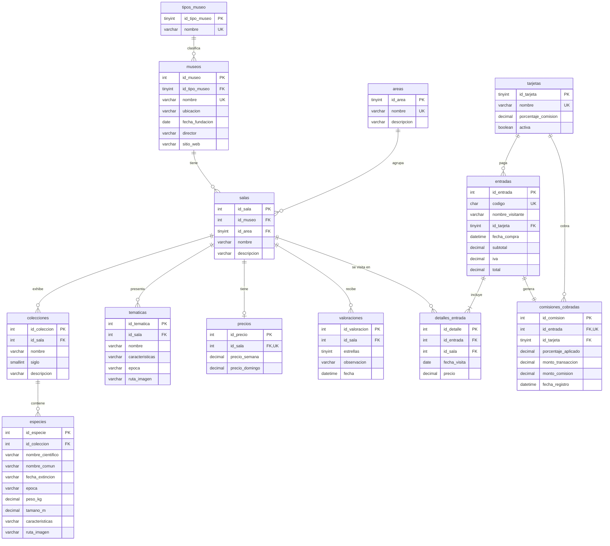

# Base de datos `mahn_db`

Documentación de la base de datos del proyecto MAHN 3.0: modelo relacional, estándares aplicados y diccionario de
datos. El script completo está en [database/MAHN_DB.sql](../database/MAHN_DB.sql) (MySQL 8.0.16 o superior).

## 1. Modelo relacional

**Reglas del modelo**

- Una sala pertenece a un museo y a un área. Las salas que exhiben especies lo hacen por medio de sus colecciones; las
  que no, usan temáticas.
- Cada sala tiene un único precio: uno de lunes a sábado y otro diferido para los domingos.
- Una entrada se paga con una tarjeta y puede incluir varias salas en varios días (`detalles_entrada`). Una misma sala
  no se repite en el mismo día de una entrada.
- Al insertar una entrada, el disparador `tg_entradas_ai` crea su registro en `comisiones_cobradas` con el porcentaje
  vigente de la tarjeta: `monto_comision = ROUND(total * porcentaje / 100, 2)`.
- Las valoraciones son anónimas: solo guardan la sala, las estrellas (1 a 5), la observación y la fecha.

**Integridad referencial:** `ON DELETE RESTRICT` protege la información histórica (no se puede borrar un museo con
salas, una sala con colecciones, temáticas o entradas vendidas, ni una tarjeta con ventas). Se usa `ON DELETE CASCADE`
solo para datos que dependen totalmente de su padre: el precio y las valoraciones de una sala, y los detalles y la
comisión de una entrada.

**Vistas**

| Vista | Uso |
|---|---|
| `vw_valoracion_salas` | Promedio y cantidad de valoraciones por sala (reporte de valoración) |
| `vw_comisiones_detalle` | Cada comisión cobrada con su tarjeta y su entrada |
| `vw_tarifas_salas` | Salas con sus precios de lunes a sábado y domingo |

## 2. Estándares aplicados

| Elemento | Estándar | Ejemplo |
|---|---|---|
| Base de datos | minúsculas con sufijo `_db` | `mahn_db` |
| Tablas | sustantivo en plural, minúsculas, `snake_case`, sin tildes ni ñ | `salas`, `detalles_entrada` |
| Columnas | minúsculas, `snake_case`, sin tildes ni ñ | `fecha_fundacion`, `tamano_m` |
| Llave primaria | `id_<entidad en singular>`, entero sin signo autoincremental | `id_sala` |
| Llave foránea | mismo nombre que la llave primaria referenciada | `salas.id_museo` |
| Restricción PK | `pk_<tabla>` | `pk_salas` |
| Restricción FK | `fk_<tabla>_<tabla referenciada>` | `fk_salas_museos` |
| Restricción única | `uq_<tabla>_<columnas>` | `uq_salas_museo_nombre` |
| Restricción de verificación | `ck_<tabla>_<regla>` | `ck_valoraciones_estrellas` |
| Índice | `ix_<tabla>_<columna>` | `ix_detalles_entrada_fecha_visita` |
| Vista | `vw_<descripción>` | `vw_valoracion_salas` |
| Disparador | `tg_<tabla>_<momento><evento>` (`a` = after, `i` = insert) | `tg_entradas_ai` |
| Montos | `DECIMAL(10,2)` en dólares (USD) | `precio_semana` |
| Porcentajes | `DECIMAL(5,2)` entre 0 y 100 | `porcentaje_comision` |
| Fechas | `DATE` para días y `DATETIME` para fecha y hora; prefijo `fecha_` | `fecha_visita`, `fecha_compra` |
| Booleanos | `BOOLEAN` con nombre de estado | `activa` |
| Documentación | `COMMENT` en todas las tablas y columnas | ver diccionario |
| Motor y codificación | InnoDB, `utf8mb4`, intercalación `utf8mb4_es_0900_ai_ci` | — |

## 3. Diccionario de datos

Generado a partir de los comentarios de `information_schema` de la base creada con el script.

### `tipos_museo`

Catálogo de los tipos de museo

| Columna | Tipo | Nulo | Llave | Por defecto | Descripción |
|---|---|---|---|---|---|
| `id_tipo_museo` | tinyint unsigned | No | PK | — | Identificador del tipo de museo |
| `nombre` | varchar(30) | No | UQ | — | Nombre del tipo de museo: Arte, Historia, Musical o Militar |

Restricciones: `PRIMARY` (PRIMARY KEY), `uq_tipos_museo_nombre` (UNIQUE)

### `areas`

Catálogo de áreas de investigación y temáticas a las que pertenece cada sala

| Columna | Tipo | Nulo | Llave | Por defecto | Descripción |
|---|---|---|---|---|---|
| `id_area` | tinyint unsigned | No | PK | — | Identificador del área |
| `nombre` | varchar(60) | No | UQ | — | Nombre del área (Antropología, Paleontología, Genoma, etc.) |
| `descripcion` | varchar(255) | No | — | — | Descripción breve del área |

Restricciones: `PRIMARY` (PRIMARY KEY), `uq_areas_nombre` (UNIQUE)

### `museos`

Museos cuyas salas se administran y venden en la aplicación

| Columna | Tipo | Nulo | Llave | Por defecto | Descripción |
|---|---|---|---|---|---|
| `id_museo` | int unsigned | No | PK | — | Identificador del museo |
| `id_tipo_museo` | tinyint unsigned | No | FK → tipos_museo | — | Tipo de museo (FK a tipos_museo) |
| `nombre` | varchar(120) | No | UQ | — | Nombre del museo |
| `ubicacion` | varchar(200) | No | — | — | Dirección o ubicación del museo |
| `fecha_fundacion` | date | No | — | — | Fecha de fundación del museo |
| `director` | varchar(100) | No | — | — | Nombre de la persona que dirige el museo |
| `sitio_web` | varchar(200) | Sí | — | — | Sitio web oficial (debe iniciar con http:// o https://) |

Restricciones: `ck_museos_sitio_web` (CHECK), `fk_museos_tipos_museo` (FOREIGN KEY), `PRIMARY` (PRIMARY KEY), `uq_museos_nombre` (UNIQUE)

### `salas`

Salas de exhibición de cada museo

| Columna | Tipo | Nulo | Llave | Por defecto | Descripción |
|---|---|---|---|---|---|
| `id_sala` | int unsigned | No | PK | — | Identificador de la sala (se codifica en el QR de la sala) |
| `id_museo` | int unsigned | No | FK → museos | — | Museo al que pertenece la sala (FK a museos) |
| `id_area` | tinyint unsigned | No | FK → areas | — | Área de investigación o temática de la sala (FK a areas) |
| `nombre` | varchar(120) | No | — | — | Nombre de la sala |
| `descripcion` | varchar(600) | No | — | — | Descripción de la sala |

Restricciones: `fk_salas_areas` (FOREIGN KEY), `fk_salas_museos` (FOREIGN KEY), `PRIMARY` (PRIMARY KEY), `uq_salas_museo_nombre` (UNIQUE)

### `colecciones`

Colecciones que se exhiben en las salas

| Columna | Tipo | Nulo | Llave | Por defecto | Descripción |
|---|---|---|---|---|---|
| `id_coleccion` | int unsigned | No | PK | — | Identificador de la colección |
| `id_sala` | int unsigned | No | FK → salas | — | Sala donde se exhibe la colección (FK a salas) |
| `nombre` | varchar(120) | No | — | — | Nombre de la colección |
| `siglo` | smallint | No | — | — | Siglo al que pertenece la colección: positivo = d. C., negativo = a. C. (ej. 20 = siglo XX, -1 = siglo I a. C.) |
| `descripcion` | varchar(1000) | No | — | — | Observación o descripción detallada de lo que representa la colección |

Restricciones: `ck_colecciones_siglo` (CHECK), `fk_colecciones_salas` (FOREIGN KEY), `PRIMARY` (PRIMARY KEY), `uq_colecciones_sala_nombre` (UNIQUE)

### `especies`

Especies que se exhiben en cada colección

| Columna | Tipo | Nulo | Llave | Por defecto | Descripción |
|---|---|---|---|---|---|
| `id_especie` | int unsigned | No | PK | — | Identificador de la especie en exhibición |
| `id_coleccion` | int unsigned | No | FK → colecciones | — | Colección a la que pertenece el ejemplar (FK a colecciones) |
| `nombre_cientifico` | varchar(120) | No | — | — | Nombre científico (binomial) de la especie |
| `nombre_comun` | varchar(120) | No | — | — | Nombre común de la especie |
| `fecha_extincion` | varchar(80) | Sí | — | — | Fecha o periodo aproximado de extinción; NULL si la especie no está extinta |
| `epoca` | varchar(100) | No | — | — | Época geológica o histórica en la que vivió en la Tierra |
| `peso_kg` | decimal(16,6) | No | — | — | Peso promedio de un adulto en kilogramos |
| `tamano_m` | decimal(10,4) | No | — | — | Tamaño representativo (largo, altura o envergadura) en metros |
| `caracteristicas` | varchar(1000) | No | — | — | Características principales de la especie |
| `ruta_imagen` | varchar(255) | Sí | — | — | Ruta relativa de la imagen (carpeta imagenes/ o recursos de la aplicación) |

Restricciones: `ck_especies_peso` (CHECK), `ck_especies_tamano` (CHECK), `fk_especies_colecciones` (FOREIGN KEY), `PRIMARY` (PRIMARY KEY), `uq_especies_coleccion_nombre` (UNIQUE)

### `tematicas`

Temáticas de las salas que no son de exhibición de especies

| Columna | Tipo | Nulo | Llave | Por defecto | Descripción |
|---|---|---|---|---|---|
| `id_tematica` | int unsigned | No | PK | — | Identificador de la temática |
| `id_sala` | int unsigned | No | FK → salas | — | Sala que presenta la temática (FK a salas) |
| `nombre` | varchar(120) | No | — | — | Nombre de la temática |
| `caracteristicas` | varchar(1000) | No | — | — | Características de la temática |
| `epoca` | varchar(100) | No | — | — | Época a la que corresponde la temática |
| `ruta_imagen` | varchar(255) | Sí | — | — | Ruta relativa de la imagen de la temática |

Restricciones: `fk_tematicas_salas` (FOREIGN KEY), `PRIMARY` (PRIMARY KEY), `uq_tematicas_sala_nombre` (UNIQUE)

### `precios`

Precio de entrada de cada sala según el día de la semana

| Columna | Tipo | Nulo | Llave | Por defecto | Descripción |
|---|---|---|---|---|---|
| `id_precio` | int unsigned | No | PK | — | Identificador del precio |
| `id_sala` | int unsigned | No | FK → salas, UQ | — | Sala a la que corresponde el precio (FK a salas, uno por sala) |
| `precio_semana` | decimal(10,2) | No | — | — | Precio de la entrada de lunes a sábado en dólares (USD) |
| `precio_domingo` | decimal(10,2) | No | — | — | Precio diferido de la entrada los domingos en dólares (USD) |

Restricciones: `ck_precios_domingo` (CHECK), `ck_precios_semana` (CHECK), `fk_precios_salas` (FOREIGN KEY), `PRIMARY` (PRIMARY KEY), `uq_precios_sala` (UNIQUE)

### `tarjetas`

Tipos de tarjeta aceptados y la comisión que cobra cada marca

| Columna | Tipo | Nulo | Llave | Por defecto | Descripción |
|---|---|---|---|---|---|
| `id_tarjeta` | tinyint unsigned | No | PK | — | Identificador de la tarjeta |
| `nombre` | varchar(40) | No | UQ | — | Marca de la tarjeta: VISA, Mastercard, American Express, Diners Club, Union Pay |
| `porcentaje_comision` | decimal(5,2) | No | — | — | Porcentaje de comisión que cobra la marca por transacción |
| `activa` | tinyint(1) | No | — | 1 | Indica si la tarjeta se acepta actualmente en las cajas |

Restricciones: `ck_tarjetas_porcentaje` (CHECK), `PRIMARY` (PRIMARY KEY), `uq_tarjetas_nombre` (UNIQUE)

### `entradas`

Entradas vendidas en las cajas del museo

| Columna | Tipo | Nulo | Llave | Por defecto | Descripción |
|---|---|---|---|---|---|
| `id_entrada` | int unsigned | No | PK | — | Identificador de la entrada |
| `codigo` | char(12) | No | UQ | — | Código único de la entrada que se codifica en el QR |
| `nombre_visitante` | varchar(100) | No | — | — | Nombre de la persona visitante |
| `id_tarjeta` | tinyint unsigned | No | FK → tarjetas | — | Tarjeta con la que se pagó (FK a tarjetas) |
| `fecha_compra` | datetime | No | — | CURRENT_TIMESTAMP | Fecha y hora de la venta |
| `subtotal` | decimal(10,2) | No | — | — | Suma de los precios de las salas (USD) |
| `iva` | decimal(10,2) | No | — | — | Impuesto al valor agregado del 13 % sobre el subtotal (USD) |
| `total` | decimal(10,2) | No | — | — | Total pagado = subtotal + IVA (USD) |

Restricciones: `ck_entradas_montos` (CHECK), `fk_entradas_tarjetas` (FOREIGN KEY), `PRIMARY` (PRIMARY KEY), `uq_entradas_codigo` (UNIQUE)

### `detalles_entrada`

Salas y días de visita incluidos en cada entrada

| Columna | Tipo | Nulo | Llave | Por defecto | Descripción |
|---|---|---|---|---|---|
| `id_detalle` | int unsigned | No | PK | — | Identificador del detalle |
| `id_entrada` | int unsigned | No | FK → entradas | — | Entrada a la que pertenece el detalle (FK a entradas) |
| `id_sala` | int unsigned | No | FK → salas | — | Sala que se visitará (FK a salas) |
| `fecha_visita` | date | No | — | — | Día en que la entrada autoriza el ingreso a la sala |
| `precio` | decimal(10,2) | No | — | — | Precio cobrado según el día de la semana (USD) |

Restricciones: `ck_detalles_entrada_precio` (CHECK), `fk_detalles_entrada_entradas` (FOREIGN KEY), `fk_detalles_entrada_salas` (FOREIGN KEY), `PRIMARY` (PRIMARY KEY), `uq_detalles_entrada_sala_fecha` (UNIQUE)

### `comisiones_cobradas`

Registro automático de la comisión cobrada por cada venta

| Columna | Tipo | Nulo | Llave | Por defecto | Descripción |
|---|---|---|---|---|---|
| `id_comision` | int unsigned | No | PK | — | Identificador del registro de comisión |
| `id_entrada` | int unsigned | No | FK → entradas, UQ | — | Entrada que originó la comisión (FK a entradas, una por entrada) |
| `id_tarjeta` | tinyint unsigned | No | FK → tarjetas | — | Marca de tarjeta a la que se debe pagar la comisión (FK a tarjetas) |
| `porcentaje_aplicado` | decimal(5,2) | No | — | — | Porcentaje de comisión vigente al momento de la venta |
| `monto_transaccion` | decimal(10,2) | No | — | — | Monto total cobrado a la tarjeta (USD) |
| `monto_comision` | decimal(10,2) | No | — | — | Valor de la comisión = monto_transaccion * porcentaje_aplicado / 100 (USD) |
| `fecha_registro` | datetime | No | — | — | Fecha y hora de la venta que generó la comisión |

Restricciones: `ck_comisiones_cobradas_montos` (CHECK), `fk_comisiones_cobradas_entradas` (FOREIGN KEY), `fk_comisiones_cobradas_tarjetas` (FOREIGN KEY), `PRIMARY` (PRIMARY KEY), `uq_comisiones_cobradas_entrada` (UNIQUE)

### `valoraciones`

Valoraciones anónimas que los visitantes hacen de cada sala

| Columna | Tipo | Nulo | Llave | Por defecto | Descripción |
|---|---|---|---|---|---|
| `id_valoracion` | int unsigned | No | PK | — | Identificador de la valoración |
| `id_sala` | int unsigned | No | FK → salas | — | Sala valorada (FK a salas) |
| `estrellas` | tinyint unsigned | No | — | — | Calificación de 1 a 5 estrellas |
| `observacion` | varchar(500) | Sí | — | — | Comentario opcional del visitante |
| `fecha` | datetime | No | — | CURRENT_TIMESTAMP | Fecha y hora en que se registró la valoración |

Restricciones: `ck_valoraciones_estrellas` (CHECK), `fk_valoraciones_salas` (FOREIGN KEY), `PRIMARY` (PRIMARY KEY)

